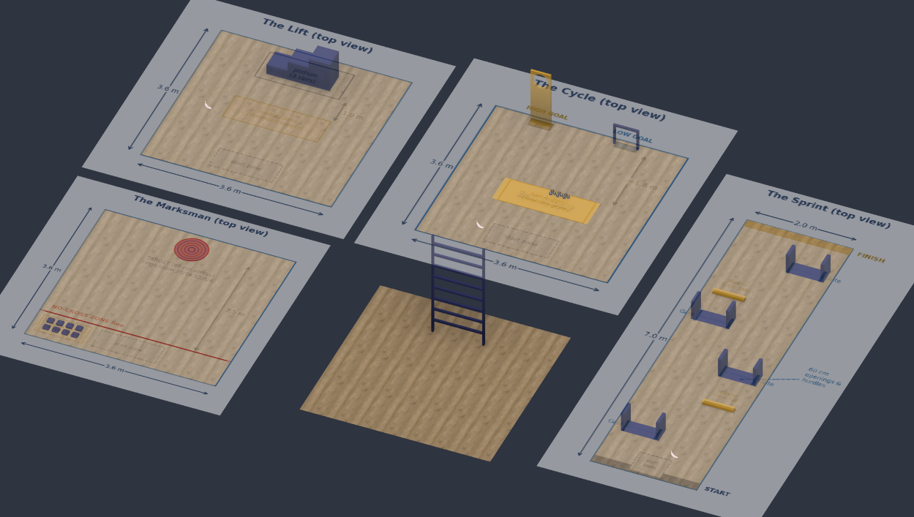

# EWU ASME SDC 2027 Robot

> The Eastern Washington University ASME chapter's robot for PODIUM, the 2027 ASME Student Design Competition: one robot competing across five scored events in speed, strength, throughput, accuracy, and climbing. **Work in progress.**

<p align="center">
  
</p>

> The official rulebook and Q&A are in [`/docs/rules`](/docs/rules). The custom Operator Console has its own repo: [EWU-ASME-SDC-2027-Transmitter](https://github.com/SethHibpshman/EWU-ASME-SDC-2027-Transmitter).

## Table of Contents

- [Overview](#overview)
- [Competition Summary](#competition-summary)
  - [Run Format](#run-format)
  - [Robot Requirements](#robot-requirements)
  - [The Five Disciplines](#the-five-disciplines)
  - [Rankings, Playoff, and Awards](#rankings-playoff-and-awards)
- [Key Q&A Clarifications](#key-qa-clarifications)
- [Playfield Scale Models](#playfield-scale-models)
- [Inspection Checklist](#inspection-checklist)
- [System Design](#system-design)
- [Bill of Materials](#bill-of-materials)
- [Author](#author)
- [AI Disclosure](#ai-disclosure)
- [License](#license)

## Overview

PODIUM is the 2027 season of the ASME Student Design Competition (SDC) and Stage 1 of a two-season program, The ASME Engineering Games. Instead of one game, it plays like a track meet: five separate Disciplines, each on its own field, each rewarding a different engineering strength. No robot can be best at everything, so teams choose where to specialize while still scoring across all five.

This repo is the home of the Eastern Washington University ASME chapter's 2027 robot. It collects the rules, our notes on the official Q&A, scale models of every playfield, and (as the season goes on) the robot's design files, firmware, and documentation. The same robot class carries into the 2028 season, so the robot is being designed to be modular and upgradeable.

**Status:** concept and planning. Robot design files will be added as they are made.

## Competition Summary

A short summary in our own words. The [rulebook](/docs/rules) governs, and the [Q&A](/docs/rules) supersedes the rulebook where they differ.

### Run Format

| Phase | Length | Control |
|---|---|---|
| **Autonomous** | 30 seconds | Onboard program or stored energy only, no human input |
| **Crewed** | 2 minutes | Up to four Crew members, driving through the team's own Operator Console |

Every Run counts (no practice runs), each team gets one Run per Discipline on Day 1, and the Robot must be placed and ready within 60 seconds of being called.

### Robot Requirements

| Category | Requirement |
|---|---|
| **Starting size** | Fits in a 40 x 40 x 40 cm cube, in the team's own rigid container |
| **Expanded size** | Up to 75 cm in any horizontal direction and 120 cm tall after the start |
| **Weight** | 15 kg or less as competed, batteries included |
| **Power** | Onboard batteries, 24 V nominal max per battery, main switch, fire-safe charging bag |
| **Control** | One link only: a slack tether or a single license-free wireless link (2.4 / 5 GHz) |
| **Pneumatics** | 60 psi max, with a visible gauge and relief valve |
| **Stored energy** | Allowed if the Robot can fully restore it itself during the Run |
| **Required fittings** | Team identifier, a 3 x 3 cm flat area for a marker, and an Ascent anchor point rated for the Robot's weight |
| **Prohibited** | Flight, combustion, field damage, unsafe launches, sharp edges, lasers above Class 1 |

### The Five Disciplines

Four Disciplines use a 3.6 x 3.6 m field; The Sprint uses a 2.0 x 7.0 m lane.

| Discipline | Objective | Scoring | Max |
|---|---|---|---|
| **The Sprint** | Slalom through 4 Gates and over 2 Hurdles (5 cm tall), as fast as possible | 100 minus 1 per second, minus penalties; +10 for clearing Gate 1 autonomously | 100 |
| **The Lift** | Place 1, 2, and 4 kg Dumbbells on a podium with tiers at 20, 40, and 60 cm | 5 to 60 per Dumbbell by mass and tier; x1.5 if placed autonomously | 120 |
| **The Cycle** | Score ~65 mm ball-pit balls through a floor goal or a 1.0 m high goal | 2 per Low Goal ball, 5 per High Goal ball; doubled in autonomous; max 3 balls held | 140 |
| **The Marksman** | Launch bean bags onto a ringed floor target 2.5 m past a No-Cross line | 20/16/12/8/4 by ring; autonomous bag doubled; launchers must start unloaded | 160 |
| **The Ascent** | Climb a ladder and hold the highest Height Band at the buzzer | 30 / 60 / 90 at 0.5 / 1.0 / 1.5 m, 120 at the 2.0 m Summit; x1.5 if reached autonomously | 180 |

### Rankings, Playoff, and Awards

- **All-Around Score:** the sum of a team's best score in each Discipline, up to 700. It sets the Day 1 rankings.
- **Playoff (Day 2):** top teams each pick a partner to form a Pair, then Pairs play a seeded single-elimination bracket. Each match is The Cycle plus a featured Discipline. No defense is allowed.
- **Awards:** PODIUM Champion (Gold, Silver, Bronze Pair), All-Around, and per-Discipline trophies, plus judged awards (Laurel, Blueprint, Ingenuity, Spirit of the Games, Rising Star) based on an optional 10 to 30 page design report due 30 days before the event.

## Key Q&A Clarifications

From the [October 13, 2026 Q&A](/docs/rules), which overrides the rulebook where they conflict:

| Topic | Clarification |
|---|---|
| **End effectors** | Swappable end effectors are allowed if they attach without tools. All must be inspected and fit in the 40 cm container together. |
| **Reconfiguring** | Any change to fit, form, or function between Runs is not allowed, including adjusting the Robot for a specific Discipline. Only repairs, recalibration, and code changes. |
| **Starting Zone** | A marked 60 x 60 cm square in every Discipline |
| **The Sprint** | Hurdles are 60 cm long, 5 cm tall, 2 to 4 cm thick. Gates are 5 x 5 cm posts, 30 cm tall, 60 cm opening. Neither is bolted down, and knocking them out of place is penalized. |
| **The Lift** | Dumbbells within 5% of marked mass, six of each, grouped Light / Standard / Heavy from left to right |
| **The Cycle** | Low Goal 40 x 40 cm, centered 2.50 m from the left edge. High Goal 30 cm ring at 1.0 m, centered 0.90 m from the left edge. A backstop runs behind the goals, and scored balls return through a trough and can be scored again. |
| **The Marksman** | Rings are 6 cm wide (radii 6, 12, 18, 24, 30 cm). Bags are not cleared during a Run. No measuring or markers on the field. |
| **The Ascent** | Open ladder, no wall face: round 25 mm rungs, 20 cm on center, first rung at 20 cm, top rung at 2.2 m, at least 120 cm wide. No platform at the top. |

## Playfield Scale Models

The image at the top of this page shows scale models of all five fields, modeled in Fusion 360 from the dimensions in the rulebook and Q&A. They are used to check reach, clearances, and mechanism sizing before anything is built. The model files will be added to [`/hardware/playfield_models`](/hardware/playfield_models).

## Inspection Checklist

Condensed from Section 8.1 of the rulebook.

| Item | Rule |
|---|---|
| Fits in the 40 cm cube on its own | 7.1-2 |
| Expansion within 75 cm wide, 120 cm tall | 7.1-3 |
| 15 kg or less | 7.1-4 |
| Battery 24 V nominal or less, secured, with a main switch | 7.3-2 |
| Fire-safe charging bag | 7.3-2, 9-2 |
| Stored energy can be restored by the Robot | 7.3-3 |
| One control link, can be disabled | 7.3-5 |
| Pneumatics 60 psi or less, gauge and relief valve | 7.3-6 |
| Ascent anchor point | 7.4-3 |
| Team identifier and marker area | 7.4-1 |
| No prohibited features, safe edges | 7.4-2 |
| Z87 / EN166 eye protection for every team member | 9-2 |

## System Design

The robot is still in the concept stage. Subsystems and design files will be documented here as they are developed.

| Subsystem | Status |
|---|---|
| Operator Console | Custom handheld transmitter, in design. See [EWU-ASME-SDC-2027-Transmitter](https://github.com/SethHibpshman/EWU-ASME-SDC-2027-Transmitter). |
| Chassis and drivetrain | Not started |
| Mechanisms and end effectors | Not started |
| Electronics and firmware | Not started |

```
EWU-ASME-SDC-2027-Robot/
├── assets/
│   └── venue_overview_fusion_models.png    # Render of the playfield scale models
├── docs/
│   └── rules/
│       ├── CY27 ASME SDC Rules FINAL_August 2026.pdf
│       └── CY27 - SDC QA 10.13.26.pdf
└── hardware/
    └── playfield_models/                   # Fusion 360 playfield models
```

## Bill of Materials

To be added as parts are selected.

## Author

**Seth Hibpshman**  
Student of Electrical Engineering, Eastern Washington University

## AI Disclosure
_AI (LLM) tools were used in the drafting and editing of this README._

## License

[GNU General Public License v3.0](LICENSE). The rulebook and Q&A PDFs in `/docs/rules` are published by ASME and are included for reference only.
